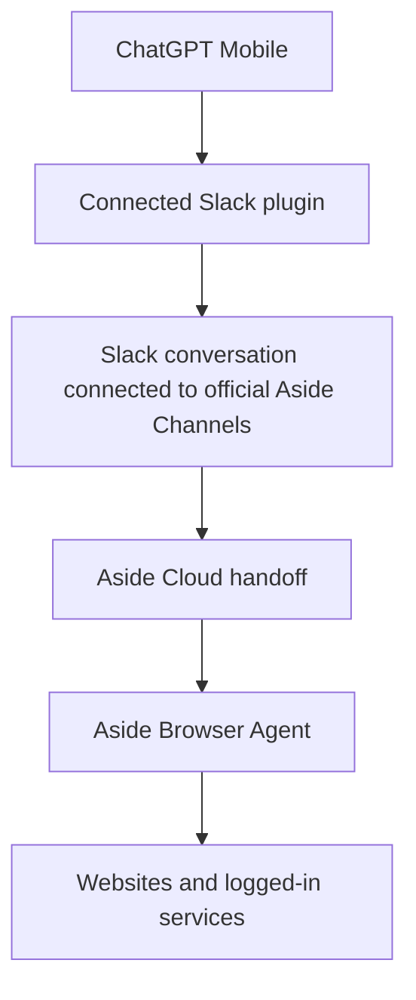

# ASIDE-GPT

ASIDE-GPT exists for one purpose: **use the official Aside Browser Agent from mobile ChatGPT without requiring the user's PC to stay online.**

It is not a new browser engine and it must not silently replace Aside with ChatGPT Work's browser.

## Preferred public path

Current official product surfaces make this the preferred path:



Why Slack:

- Aside officially ships **Channels (Remote control)** over Slack and Telegram.
- Aside's official changelog describes guided Channel connection, durable delivery, and Telegram session-control commands.
- ChatGPT can officially send and read Slack through a connected Slack plugin.
- This means ASIDE-GPT does not need to invent or reverse engineer a private Aside REST/MCP endpoint just to relay mobile instructions.

## Current activation gates

The architecture is implemented, but ASIDE-GPT must not claim full PC-free readiness until both of these are true for the user's account:

1. **Aside Channel setup** — an existing Slack conversation is verifiably connected to official Aside Channels.
2. **No-PC Cloud handoff smoke test** — a real Aside browser task is proven to start or continue while no user PC/Mac/local Aside process is online.

Until #1 is complete, the route returns `aside-channel-setup-required`.

After #1 but before #2, it returns `cloud-no-pc-execution-not-live-verified`.

Only after both pass is the path treated as ready.

## Official evidence

Current official Aside product material verifies:

- **Channels (Remote control)** on Pro.
- Slack and Telegram remote control in the official component changelog.
- **Cloud handoff** on Pro.
- Team/contact-sales capability to **start browser agent runs from your app, cron jobs, or internal tools**.
- cloud-device management in the official changelog.

Sources:

- https://aside.com/pricing
- https://docs.aside.com/changelog/components
- https://docs.aside.com/help/developers

Aside's public developer docs still do not publish the external endpoint/auth/schema behind the team programmatic-run capability. That API is therefore an optional future direct transport, not a requirement for the Slack Channels route.

## Success criterion

A task counts as **ASIDE-GPT execution** only when the actual browser work is performed by Aside.

```text
Mobile ChatGPT
  -> Slack connector
  -> official Aside Channels
  -> Cloud handoff
  -> Aside Browser Agent
```

Using another browser engine can be an explicitly requested fallback, but it must be labeled as non-Aside execution and does not satisfy the core project goal.

## What is implemented

- `packages/channels/`: official Channels transport model and activation gates.
- `packages/providers/`: Aside Remote is the primary provider; silent replacement is prohibited.
- `packages/orchestration/`: routes to `channels-slack` first and enforces Channel/no-PC verification states.
- `packages/policies/`: task risk and confirmation rules.
- `packages/approvals/`: approval boundaries retained for consequential actions.
- `packages/evidence/`: evidence requirements for completed browser work.
- `plugin/skills/aside-channel-slack/`: host workflow for ChatGPT Slack ↔ Aside Channels task relay.
- `plugin/skills/`: supporting browser, authenticated-web, research, shopping, and multi-site skills.
- `providers/aside/`: verified capability records and activation boundary.
- `legacy/local-node/`: archived first prototype that required a PC/local Aside process. It is not part of the target architecture.

## Explicitly not required by the target architecture

```text
NO user PC requirement
NO localhost bridge
NO home server
NO personal tunnel
NO local Aside CLI requirement
NO replacement Playwright browser
NO reverse-engineered Aside private API
NO cookie/password extraction
```

## Verification

```bash
npm install
npm run ci
```

The CI suite verifies that:

- Aside remains the primary browser provider.
- official Channels/Slack is the preferred ChatGPT transport.
- an unconfigured Channel cannot be guessed or treated as ready.
- the PC-free claim requires a real Cloud handoff smoke test.
- Work-native cannot be selected silently.
- non-Aside fallback requires explicit opt-in.
- approval and evidence policies continue to pass.

## Activation

See [docs/ASIDE_CHANNELS_SLACK.md](docs/ASIDE_CHANNELS_SLACK.md) and [docs/REMOTE_ACTIVATION_CHECKLIST.md](docs/REMOTE_ACTIVATION_CHECKLIST.md).

The final account-level activation is intentionally small: connect official Aside Channels to Slack, identify the verified conversation from ChatGPT, and run the two no-PC smoke tests. A direct Aside API/Remote MCP can be added later if Aside publishes or grants the team developer contract, but it is no longer the only path to mobile control.
