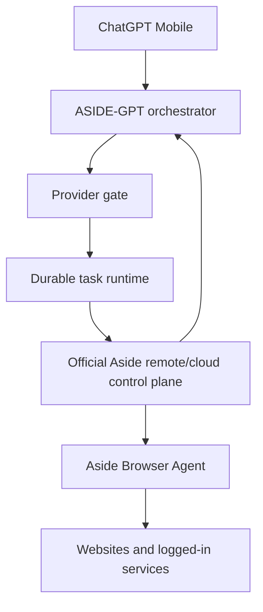

# ASIDE-GPT

ASIDE-GPT exists for one purpose: **use the official Aside Browser Agent from mobile ChatGPT without requiring the user's PC to stay online.**

It is not a new browser engine and it must not silently replace Aside with ChatGPT Work's browser.



## Current verified state

Official Aside product material currently verifies remote/cloud capabilities:

- **Channels (Remote control)** on Pro.
- **Cloud handoff** on Pro.
- Team/contact-sales capability to **start browser agent runs from your app, cron jobs, or internal tools**.
- The official changelog includes management of **active cloud devices**.

Sources:

- https://aside.com/pricing
- https://docs.aside.com/changelog/components
- https://docs.aside.com/help/developers

What is **not yet publicly documented** is the external developer contract behind those remote/cloud features: endpoint or Remote MCP URL, authentication/OAuth schema, run-status contract, remote approvals, and result/artifact retrieval.

For that reason ASIDE-GPT does not invent an API. The active provider state is `official-aside-access-required` until Aside publishes or grants the supported integration contract.

See [docs/ASIDE_REMOTE_FEASIBILITY.md](docs/ASIDE_REMOTE_FEASIBILITY.md), [docs/ASIDE_ACCESS_REQUEST.md](docs/ASIDE_ACCESS_REQUEST.md), and [docs/ORCHESTRATION.md](docs/ORCHESTRATION.md).

## Success criterion

A task counts as **ASIDE-GPT execution** only when the actual browser work is performed by Aside.

```text
Mobile ChatGPT
  -> ASIDE-GPT planner/provider gate
  -> durable dispatch + approval/recovery state
  -> official Aside Remote / Channels / Cloud Handoff surface
  -> Aside Browser Agent
```

Using another browser engine can be an explicitly requested fallback, but it must be labeled as non-Aside execution and does not satisfy the core project goal.

## What is implemented

- `packages/providers/`: Aside Remote is the primary target provider; silent replacement is prohibited.
- `packages/providers/remote-contract.ts`: transport-neutral target contract for official submit/status/recovery/input/cancel/result behavior.
- `packages/orchestration/`: task planning plus a high-level `AsideOrchestrator` that binds provider readiness to the durable runtime.
- `packages/runtime/`: XState + SQLite task ledger, transactional dispatch claims, restart recovery, ambiguous-delivery reconciliation, exact-action approvals, and provider evidence binding.
- `packages/policies/`: task risk and confirmation rules.
- `packages/approvals/`: approval boundaries retained for consequential actions.
- `packages/evidence/`: evidence requirements for completed browser work.
- `plugin/skills/`: mobile workflow skills, including `aside-remote` and `orchestration`.
- `providers/aside/`: verified capability record and activation boundary.
- `legacy/local-node/`: archived first prototype that required a PC/local Aside process. It is not part of the target architecture.

The orchestrator is safe to construct without a provider adapter: it performs no browser/network execution and returns `official-aside-access-required`. When a supported official `AsideRemoteAdapter` is supplied, the same planner becomes ready and browser work is routed through Aside.

## Orchestration behavior

The active flow is:

1. classify the task and risk;
2. resolve Aside as the primary provider;
3. fail closed if no official adapter is connected;
4. create one durable run and stable request key;
5. dispatch once;
6. on ambiguous delivery, reconcile instead of resubmitting;
7. bind consequential confirmation to the exact canonical action and expiry;
8. require provider acknowledgement before resume;
9. reject chat-based secret entry for sign-in;
10. require matching Aside task/result evidence before success.

## Explicitly not required by the target architecture

```text
NO user PC requirement
NO localhost bridge
NO home server
NO personal tunnel
NO local Aside CLI requirement
NO replacement Playwright browser
NO reverse-engineered Aside private API
NO cookie/password extraction
```

## Verification

```bash
npm install
npm run ci
```

The CI suite verifies that:

- Aside Remote remains the primary provider.
- Work-native cannot be selected silently.
- non-Aside fallback requires explicit opt-in.
- unavailable official Aside access produces a blocked state instead of a fabricated endpoint.
- a connected fixture adapter activates the Aside route without changing static product claims.
- timeout/ambiguous submission never causes automatic resubmission.
- approval is bound to the exact canonical action and provider acknowledgement.
- secure sign-in cannot accept chat secrets.
- completion requires matching Aside run evidence.
- all plugin skills validate and TypeScript builds cleanly.

## Activation

When Aside publishes or grants the official remote integration contract, implement only the thin adapter required for:

1. authentication;
2. task submission and safe request-key/idempotency behavior;
3. task status and reconciliation;
4. follow-up/steering;
5. approval relay and acknowledgement;
6. cancellation;
7. result/screenshots/files/artifact retrieval.

Then run the no-PC smoke tests in [docs/REMOTE_ACTIVATION_CHECKLIST.md](docs/REMOTE_ACTIVATION_CHECKLIST.md) and the release gates in [docs/ORCHESTRATION.md](docs/ORCHESTRATION.md).

Until then the repository is complete up to the official vendor integration boundary. The missing piece is not another browser implementation; it is access to Aside's already-advertised remote/cloud control surface.
