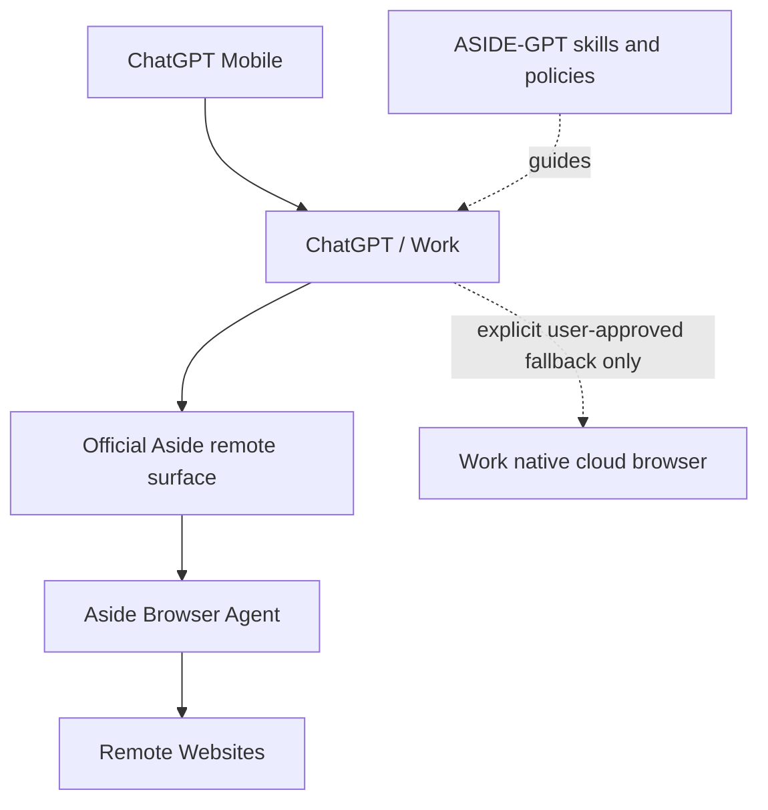

# ASIDE-GPT

ASIDE-GPT is a thin, mobile-first connector and policy layer for using the **official Aside browser agent** from ChatGPT without requiring the user's PC to stay on.

The project does **not** build a replacement browser agent. The target path is:



## Current capability status

Aside's official pricing page currently advertises `Channels (Remote control)`, `Cloud handoff`, and team-scale browser-agent runs that can be started from an app, cron job, or internal tool. That confirms an official remote/cloud product capability exists.

The public Aside Help Center currently documents the local CLI, stdio MCP command, REPL, tasks, approvals, and account controls, but does **not** publish the endpoint/auth/schema needed for ASIDE-GPT to invoke the commercial remote capability directly. Therefore:

- Aside is the **primary provider**.
- ASIDE-GPT never invents an Aside endpoint or credential format.
- If an authorized official Aside remote surface is connected, browser work routes to Aside.
- If it is not connected, the task is blocked rather than silently replaced with another browser.
- ChatGPT Work's native browser is an explicit fallback only when the user allows a non-Aside fallback.

See `docs/ASIDE_REMOTE_FEASIBILITY.md` for the evidence and integration gate.

## What is included

- `plugin/skills/`: workflow skills for Aside-first browser tasks, research, authenticated sites, shopping, and multi-site work.
- `packages/`: deterministic routing, provider, safety, approval, schema, and evidence helpers.
- `providers/aside/`: official Aside remote capability boundary and connection requirements.
- `docs/`: architecture, feasibility, security, approvals, evidence, and provider decisions.
- `legacy/local-node/`: the superseded local-PC gateway/node prototype, excluded from the active package and CI path.

## Non-negotiable product rules

```text
NO USER PC REQUIRED
NO LOCAL ASIDE CLI REQUIRED FOR THE TARGET PATH
NO LOCALHOST BRIDGE
NO PERSONAL-PC TUNNEL
NO INVENTED ASIDE API
NO SILENT PROVIDER SUBSTITUTION
```

ASIDE-GPT may use an official Aside endpoint, OAuth flow, Remote MCP surface, Channel, Cloud Handoff surface, or managed agent-run interface **only when Aside exposes/authorizes that contract**.

## Development checks

```bash
npm install
npm run ci
```

## Typical target requests

- “Aside로 네이버 주문 배송상태 확인해줘.”
- “Aside로 여러 사이트의 가격을 비교해줘.”
- “Aside에서 관리 페이지를 확인하고 제출 직전에 나에게 승인 요청해.”
- “Aside로 로그인된 대시보드들을 확인하고 결과와 스크린샷을 정리해줘.”

Sensitive actions such as sending, publishing, purchasing, deleting, account/security changes, or transferring money remain approval-gated by the execution environment.

## Fallback policy

If the official Aside remote surface is unavailable, ASIDE-GPT reports that state explicitly. It may use ChatGPT Work's native browser only when the user explicitly chooses or allows that fallback. A Work-browser result must never be represented as an Aside result.
