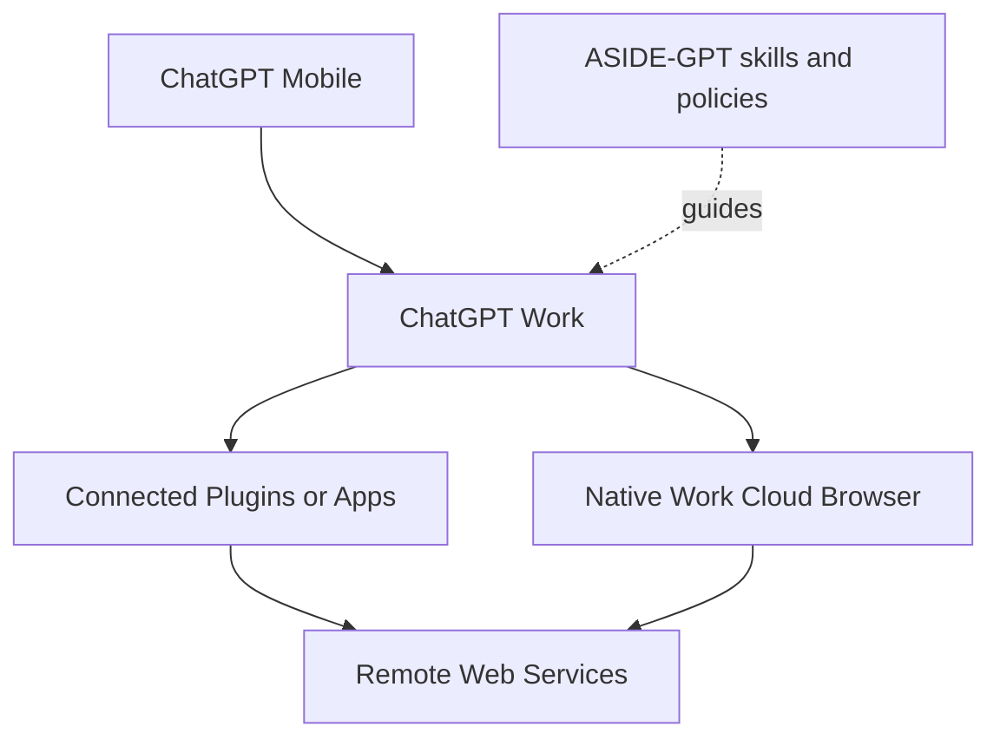

# ASIDE-GPT

ASIDE-GPT turns ChatGPT Work into a mobile-first browser-automation control plane. No user PC, local browser, home server, or persistent desktop process is required for supported Work tasks.

The user starts a task from ChatGPT on an iPhone or Android device. ChatGPT Work plans the task, selects a connected app or its native cloud browser, pauses for sign-in or confirmation when needed, and returns verifiable evidence. ASIDE-GPT contributes the workflow skills, routing rules, safety policies, approval boundaries, and result schemas that guide that work.



The cloud browser is a Work-native execution capability. This repository does not invent or call a private “Cloud Browser API,” and it does not require a local MCP gateway to reach one. When a connected app can perform the operation, Work should use that app first; when general web interaction is needed, Work should use its native cloud browser; some tasks need both.

## What is included

- `plugin/skills/`: OpenAI-style `SKILL.md` workflow skills for browser tasks, research, authenticated sites, shopping, and multi-site work.
- `packages/`: deterministic TypeScript policies, schemas, evidence validation, approval boundaries, provider catalog, and routing helpers. These helpers do not launch a browser.
- `plugin/manifest.json`: skills-only package metadata. No custom MCP endpoint is declared.
- `providers/`: the provider boundary. `work-native` is the default logical provider; Aside hosted execution is explicitly unverified and has no adapter.
- `docs/`: architecture, mobile-only constraints, Work integration, security, approvals, evidence, provider decisions, and research records.
- `legacy/local-node/`: the previous gateway/node implementation retained for historical reference and excluded from the active package and CI path.

## Quick checks

```bash
npm install
npm run ci
```

There is no active runtime service, required environment variable, heartbeat, tunnel, local CLI, or desktop process. The package is installed or imported through the supported ChatGPT Work/plugin workflow, subject to the account and workspace features available to the user.

## Typical mobile requests

- “네이버에서 주문 배송상태 확인해줘.”
- “GitHub Actions 실패한 이유를 확인하고, 안전하게 고칠 수 있는 부분을 정리해줘.”
- “여러 사이트에서 이 상품 가격을 비교하고 가장 좋은 조건을 알려줘.”
- “관리 페이지를 확인해서 보고서를 만들어줘. 제출 직전에는 승인 받아.”

Read-only work can proceed automatically when Work allows it. State-changing work pauses at the policy boundary, and externally consequential actions such as sending, publishing, purchasing, deleting, or transferring money require explicit confirmation through the host product’s confirmation flow.

## Scope and limitations

This repository defines how Work should reason about and report browser tasks; it is not a replacement browser and it is not a general-purpose remote-computer service. Work’s native browser, connected apps, authentication UI, confirmation UI, rollout, and site compatibility remain controlled by ChatGPT. See [docs/WORK_INTEGRATION.md](docs/WORK_INTEGRATION.md), [docs/PROVIDERS.md](docs/PROVIDERS.md), and [docs/OPENAI_RESEARCH.md](docs/OPENAI_RESEARCH.md).
