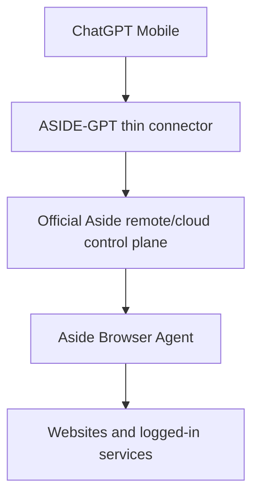

# ASIDE-GPT

ASIDE-GPT exists for one purpose: **use the official Aside Browser Agent from mobile ChatGPT without requiring the user's PC to stay online.**

It is not a new browser engine and it must not silently replace Aside with ChatGPT Work's browser.



## Current verified state

Official Aside product material currently verifies remote/cloud capabilities:

- **Channels (Remote control)** on Pro.
- **Cloud handoff** on Pro.
- Team/contact-sales capability to **start browser agent runs from your app, cron jobs, or internal tools**.
- The official changelog includes management of **active cloud devices**.

Sources:

- https://aside.com/pricing
- https://docs.aside.com/changelog/components
- https://docs.aside.com/help/developers

What is **not yet publicly documented** is the external developer contract behind those remote/cloud features: endpoint or Remote MCP URL, authentication/OAuth schema, run-status contract, remote approvals, and result/artifact retrieval.

For that reason ASIDE-GPT does not invent an API. The active provider state is `official-aside-access-required` until Aside publishes or grants the supported integration contract.

See [docs/ASIDE_REMOTE_FEASIBILITY.md](docs/ASIDE_REMOTE_FEASIBILITY.md) and [docs/ASIDE_ACCESS_REQUEST.md](docs/ASIDE_ACCESS_REQUEST.md).

## Success criterion

A task counts as **ASIDE-GPT execution** only when the actual browser work is performed by Aside.

```text
Mobile ChatGPT
  -> thin request/approval/result bridge
  -> official Aside Remote / Channels / Cloud Handoff surface
  -> Aside Browser Agent
```

Using another browser engine can be an explicitly requested fallback, but it must be labeled as non-Aside execution and does not satisfy the core project goal.

## What is implemented

- `packages/providers/`: Aside Remote is the primary target provider; silent replacement is prohibited.
- `packages/orchestration/`: browser tasks route to Aside first and stop at `official-aside-access-required` when the official connector contract is unavailable.
- `packages/policies/`: task risk and confirmation rules.
- `packages/approvals/`: approval boundaries retained for consequential actions.
- `packages/evidence/`: evidence requirements for completed browser work.
- `plugin/skills/`: workflow skills that can be reused once the official Aside connector is activated.
- `providers/aside/`: verified capability record and activation boundary.
- `legacy/local-node/`: archived first prototype that required a PC/local Aside process. It is not part of the target architecture.

## Explicitly not required by the target architecture

```text
NO user PC requirement
NO localhost bridge
NO home server
NO personal tunnel
NO local Aside CLI requirement
NO replacement Playwright browser
NO reverse-engineered Aside private API
NO cookie/password extraction
```

## Verification

```bash
npm install
npm run ci
```

The CI suite verifies that:

- Aside Remote remains the primary provider.
- Work-native cannot be selected silently.
- non-Aside fallback requires explicit opt-in.
- unavailable official Aside access produces a blocked state instead of a fabricated endpoint.
- approval and evidence policies continue to pass.

## Activation

When Aside publishes or grants the official remote integration contract, implement only the thin adapter required for:

1. authentication;
2. task submission;
3. task status;
4. follow-up/steering;
5. approval relay;
6. result/screenshots/artifact retrieval.

Then run the no-PC smoke tests in [docs/REMOTE_ACTIVATION_CHECKLIST.md](docs/REMOTE_ACTIVATION_CHECKLIST.md).

Until then the repository is complete up to the official vendor integration boundary. The missing piece is not another browser implementation; it is access to Aside's already-advertised remote/cloud control surface.
