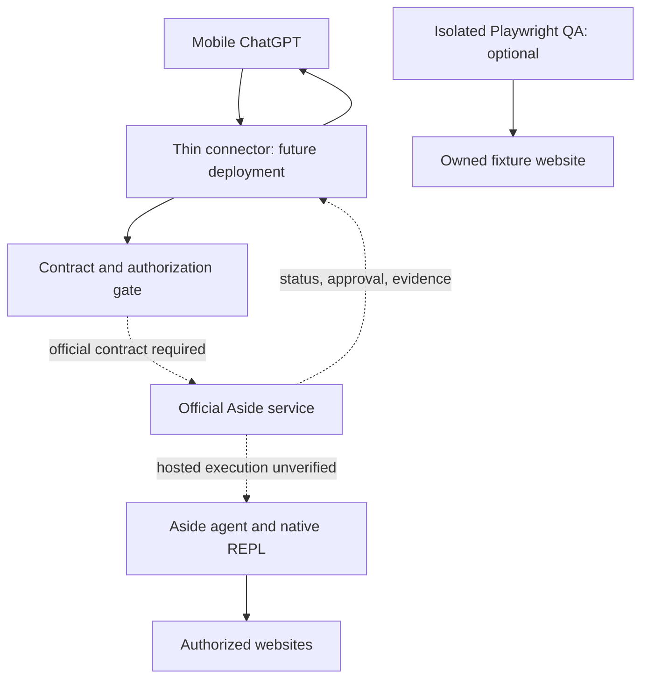

# ADR-0003: Aside-owned execution with optional test tooling

Date: 2026-09-12
Status: Accepted for design and preflight tooling; production execution BLOCKED.
Feasibility verdict for mobile-only official Aside execution: NOT PUBLICLY VERIFIED.

## Decision

Keep the official Aside agent as the only production browser writer. Use its
documented native REPL when Aside chooses deterministic steps. Do not attach a
second Playwright agent to its production session. Permit external Playwright
only for isolated, project-owned test fixtures. Do not install or run another
browser agent under the Aside name.

This extends the Aside-first architecture on main; it does not revive PR #3.
This ADR qualifies the older phrase "remote/cloud capability VERIFIED": product
advertising is verified, but PC-free browser execution is not yet demonstrated.

## Evidence and comparison

| Candidate | Capability | Decision | Does it remove the missing Aside contract? |
| --- | --- | --- | --- |
| Aside native REPL / Asidewright | Aside's own deterministic browser controls | Reuse through official Aside execution | No |
| Playwright Library | Launch or attach to an existing browser | Optional isolated fixture QA | No |
| microsoft/playwright-mcp | Exposes Playwright controls to an agent | Not installed in production; no parallel writer | No |
| browser-use/browser-use | A separate browser agent | Alternative product only; not incorporated | No |
| Existing TypeScript types and node:test | Contract review, composition invariants and unit tests | Implement now without new dependencies | No |
| Remote MCP SDK / schema validator | A future connector's transport and input validation | Select only after Aside's actual contract is available | No |

Aside's engineering article describes its own REPL, Asidewright and modified
Chromium. Sharing Playwright syntax does not expose that agent as a reusable
public SDK. Playwright connect requires a compatible existing server endpoint;
connectOverCDP needs an existing Chromium debugging endpoint and has lower
fidelity. Neither creates an Aside-hosted runtime or grants access to Aside.

Sources checked:
- https://aside.com/blog/how-we-built-the-sota-browser-agent-that-outperforms-fable
- https://docs.aside.com/help/developers
- https://playwright.dev/docs/api/class-browsertype
- https://github.com/microsoft/playwright-mcp
- https://github.com/browser-use/browser-use

## Product claims versus deployment proof

The prior review observed Cloud handoff and Enterprise app/cron-triggered runs at
https://aside.com/pricing. Re-fetching that page in this implementation turn
returned an error, so these are prior observations, not newly verified access.
Channels are described at https://docs.aside.com/changelog/components.
No pricing claim is an API specification or proof of mobile-only onboarding.
Do not infer hosted sessions from cloud devices, data sync, model inference,
a scheduled routine, or a remote-control channel.

## Detailed target topology

Dashed links below are proposed boundaries, not available endpoints.

There is deliberately no link from fixture QA to Aside's account, profile,
cookies, live browser endpoint or vault. Work Cloud Browser is not in the
primary path. Cloud developer tooling does not mean a user PC is required.

## Responsibilities and implementation status

| Component | Responsibility | Status |
| --- | --- | --- |
| Composition review module | Reject agent substitution and incomplete capability evidence | Implemented and unit-tested |
| Existing task policies | Risk classification and policy instructions | Existing; not a production enforcement service |
| Official adapter | Map task/approval/status/result operations to vendor contract | Blocked, no URL or network client |
| ChatGPT-facing connector | Supported authenticated external interface | Future; no deployment or installability claim |
| Run ledger | Persist provider run IDs and pending approvals | Proposed, not implemented |
| Artifact forwarding | Preserve Aside evidence and redact sensitive data | Proposed |
| Playwright fixture runner | Exercise owned test sites on cloud CI | Optional future; not installed in this change |

## Lifecycle and data boundaries

1. Accept an authenticated user request; bind user, task and authorized account.
2. Check official hosted execution, mobile onboarding and integration entitlement.
   If any are absent, return a blocked report; do not select another browser.
3. Obtain scoped account authorization via the vendor-supported flow. Store only
   secret references outside model context. Never collect passwords, OTPs, cookies,
   cards or PATs in ChatGPT.
4. Submit once through the actual vendor API. Internal task IDs and vendor run IDs
   remain distinct; these are design concepts, not invented vendor field names.
5. Accept status only through authenticated polling or verified vendor events.
   Bind events to tenant/account/run; reject stale, duplicate or out-of-order events.
6. On sign-in or approval, pause and show the vendor-approved mobile interaction.
   Bind approval to exact action, target, amount if any, run and expiry. Any change
   invalidates approval. Do not translate a natural-language "yes" directly into
   an unscoped vendor approve call.
7. Continue through Aside. Only Aside controls the live browser. External QA
   cannot repair a failed Aside action or click on its behalf.
8. Report completion only after vendor completion plus matching evidence.
   Include task/run identity, executor identity, time, source, extracted values,
   performed actions and approval state. Label fixtures and mocks explicitly.
9. If the phone disconnects, the future cloud adapter and Aside must retain run
   state. Pending human approval stays pending; it never expires into approval.

## Persistence, errors and operational ownership

Start with one thin service and one durable run/approval ledger, not an agent
platform. Actual hosting/database choice awaits the official transport contract
and cost approval. No user server, cron host or tunnel is introduced.

Use unique submission keys if supported. If a POST times out after dispatch,
record submission-uncertain and reconcile status; do not retry a purchase.
Reconnect status with bounded backoff. Persist event deduplication and approval
consumption transactionally. Recover read-only status after restart; never
replay a consequential action automatically. Cancellation is not reported as
successful until the vendor confirms it.

Vendor owns browser/session/vault lifecycle. Connector operator owns identity
isolation, queue durability, audit redaction, retention and rate limits. No
credentials or full page content in routine logs. Artifacts require per-user
authorization, short-lived access and a retention/delete policy.

## Security and limits

Web content and artifact text are untrusted data, not approval authority.
Re-evaluate unexpected domain changes, uploads, account changes and payment
pages. Honor vendor and host safety UI. MFA, CAPTCHA, passkeys and site policy
can require a human or prevent completion. Universal success is not promised.

Do not operate a second writer on the Aside browser: clicks, navigation and
session changes can invalidate pending approval and evidence. A future read-only
attachment also requires explicit official support; CDP access itself is powerful
and is not a read-only permission boundary.

## Acceptance and rollout

Current phase: reviewComposition + tests + this architecture; zero production
browser calls. Review inputs are trusted developer assertions, not cryptographic
attestations. Even all-green assertions keep executionReady=false.

Before activation demonstrate, with official access:
- no desktop installation at initial account/profile creation;
- authenticated mobile task submission and Aside-hosted execution;
- mobile secure sign-in, approvals, decline and expiry;
- disconnect phone, resume status without losing pending approval;
- failure/restart/retry without duplicate external effects;
- result and artifact isolation across two users;
- no fallback engine, private API or user machine anywhere in the execution path.

Only then implement the vendor adapter, evaluate the appropriate MCP SDK and
validation dependencies, and add live integration tests. Rollback disables new
submissions while retaining status lookup for existing tasks. Mock tests never
upgrade the feasibility verdict or activate a provider.
