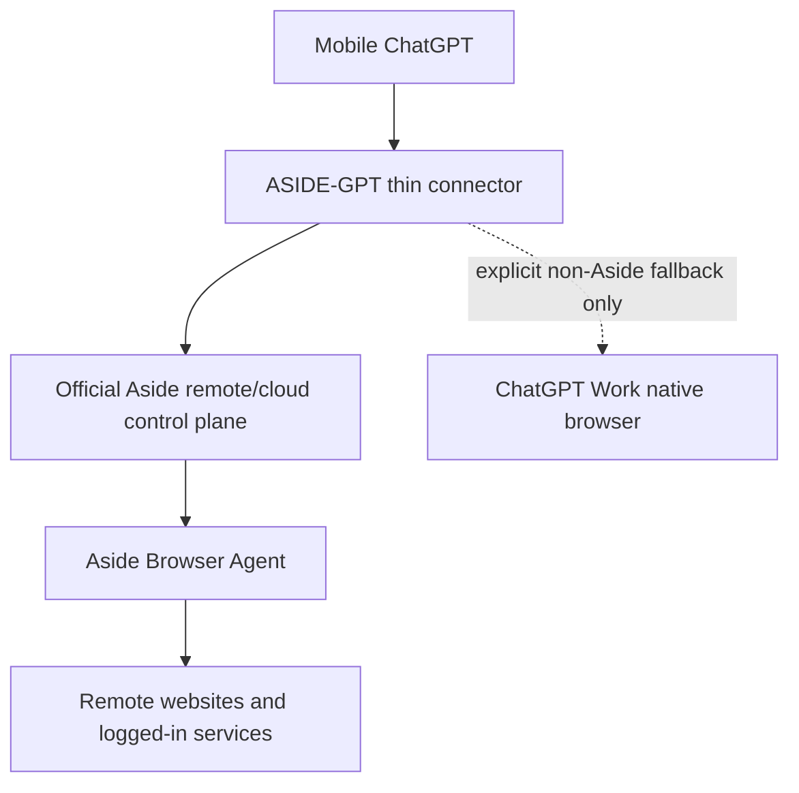

# Architecture

## Final target topology

ASIDE-GPT is a thin control-plane adapter, not a browser implementation. Its primary job is to translate a mobile ChatGPT request into the **official supported Aside remote/cloud contract**, preserve approvals, and return Aside results/evidence.

## Verified versus pending

Official Aside product material verifies the existence of `Channels (Remote control)`, `Cloud handoff`, cloud-device concepts, and team browser-agent runs started from an app, cron job, or internal tool.

The public developer documentation currently does not publish the external endpoint/auth/schema behind those capabilities. Therefore the primary path is modeled as `official-aside-access-required` until the supported contract is published or granted.

That is an integration-boundary block, not a reason to replace Aside with a new browser engine.

## Responsibilities

| Component | Responsibility | Out of scope |
| --- | --- | --- |
| ChatGPT Mobile | Natural-language commands, user decisions, approvals, results | Running browser infrastructure |
| ASIDE-GPT thin connector | Translate requests, task IDs/status, steering, approval relay, result forwarding | Implementing a browser engine or storing raw credentials |
| Official Aside remote/cloud control plane | Supported remote task/session transport and identity | Contracts invented by this repo |
| Aside Browser Agent | Actual website navigation and browser actions | Replacement by an unrelated browser while claiming Aside execution |
| Work-native browser | Optional explicit fallback when user accepts non-Aside execution | Counting as successful Aside execution |
| ASIDE-GPT policies/evidence | Risk classes, approval boundaries, verification/evidence rules | Weakening Aside's own safety boundary |

## Provider rule

1. Default to `aside-remote`.
2. If official Aside remote access is not activated, return `official-aside-access-required`.
3. Never fabricate an endpoint or reverse engineer a private Aside API.
4. Never silently fall back to another browser.
5. Use Work-native only after explicit user opt-in, and label it `non-Aside fallback`.
6. A task is an ASIDE-GPT success only when Aside actually performed the browser work.

## No-PC invariant

The target product must not require:

- a user PC or Mac to remain online;
- a localhost bridge;
- a home server;
- port forwarding or a personal tunnel;
- a local Aside CLI/browser daemon;
- a replacement Playwright runtime.

The old gateway, heartbeat, task broker, node secret, and local Aside CLI prototype remain archived under `legacy/local-node/` for historical reference only.

## Activation boundary

See `ASIDE_REMOTE_FEASIBILITY.md`, `ASIDE_ACCESS_REQUEST.md`, and `REMOTE_ACTIVATION_CHECKLIST.md`. Once the official remote integration contract is available, the remaining implementation should be a small adapter rather than a new automation platform.
