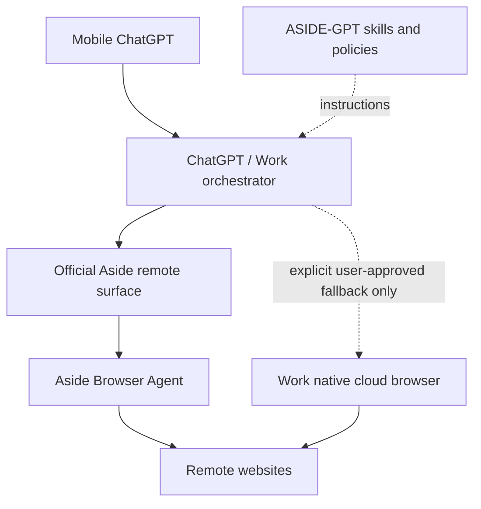

# Architecture

## Target topology

ASIDE-GPT is intentionally thin. It does not implement a browser engine, remote desktop, local daemon, private tunnel, or replacement agent. Its job is to route browser work to the official Aside remote product surface when that surface is actually authorized for the account, preserve approvals/evidence, and refuse silent provider substitution.

## Current integration state

Official Aside product material confirms remote/cloud capabilities (`Channels (Remote control)`, `Cloud handoff`, and app/cron/internal-tool triggered browser-agent runs). The reviewed public developer documentation does not expose the generic remote endpoint/auth/schema required for ASIDE-GPT to hard-code a direct client.

Accordingly, the provider state is `commercial-capability-confirmed / public-contract-not-published`.

## Responsibilities

| Component | Responsibility | Out of scope |
| --- | --- | --- |
| ChatGPT Mobile | User control surface, instructions, approvals, results | Running a local Aside process |
| ChatGPT / Work | Conversation/orchestration surface | Pretending its own browser is Aside |
| ASIDE-GPT | Aside-first routing, policy, approval/evidence rules, connection contract | Browser execution itself |
| Official Aside remote | Execute the actual Aside browser-agent run | Any invented/private endpoint |
| Aside Browser Agent | Real website interaction, browser state, Aside-native safeguards | Being reimplemented in this repo |
| Work native browser | Explicit non-Aside fallback | Defaulting silently when Aside is unavailable |

## Routing rule

1. For browser automation, prefer `aside-official-remote`.
2. Use it only if an official authorized Aside remote surface is connected.
3. If it is not connected, return a blocked/access-required state and state exactly what official access is missing.
4. Use Work's native browser only when the user explicitly chooses or allows that fallback.
5. Report which provider actually executed the browser work.

## Superseded local prototype

The old gateway, heartbeat, task broker, node secret, and local Aside CLI implementation is archived under `legacy/local-node/`. It is not an active workspace, dependency, deployment prerequisite, or acceptable solution to the user's PC-free requirement.
