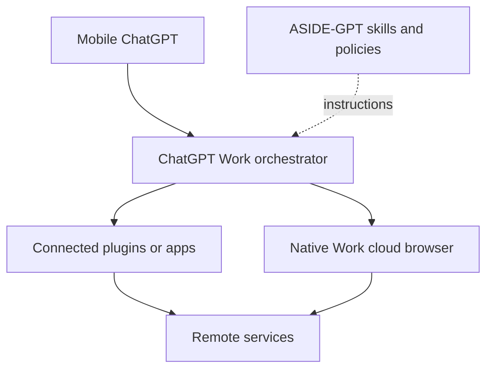

# Architecture

## Final topology

ChatGPT Work is the orchestrator. It classifies the natural-language request, chooses a connected app, its native cloud browser, or both, and owns execution, sign-in, confirmation, and continuation. ASIDE-GPT is a portable workflow package; it is not a browser, gateway, queue, or always-on agent.

## Responsibilities

| Component | Responsibility | Out of scope |
| --- | --- | --- |
| ChatGPT Mobile | Start a Work task and receive decisions/results | Running a local node |
| ChatGPT Work | Planning, executor selection, cloud execution, sign-in, confirmation, continuation | Exposing a private API assumed by this repo |
| Connected plugins/apps | Structured service data and supported actions | Replacing general web browsing |
| Work-native cloud browser | Public/authenticated website interaction | User-device browser control |
| ASIDE-GPT skills | Workflow order, routing hints, safety and evidence rules | Direct network/browser calls |
| ASIDE-GPT packages | Deterministic policy and result helpers | Credentials, sessions, remote execution |

## Executor rule

1. Prefer the relevant connected app for structured work.
2. Use Work’s native cloud browser for general websites, web-only context, or app gaps.
3. Use a hybrid plan when facts/actions span an app and a website.
4. Never represent the native browser as `https://.../cloud-browser` or another invented API.

The old gateway, heartbeat, task broker, node secret, and local Aside CLI are archived under `legacy/local-node/` and are not workspaces, scripts, dependencies, or deployment prerequisites.
