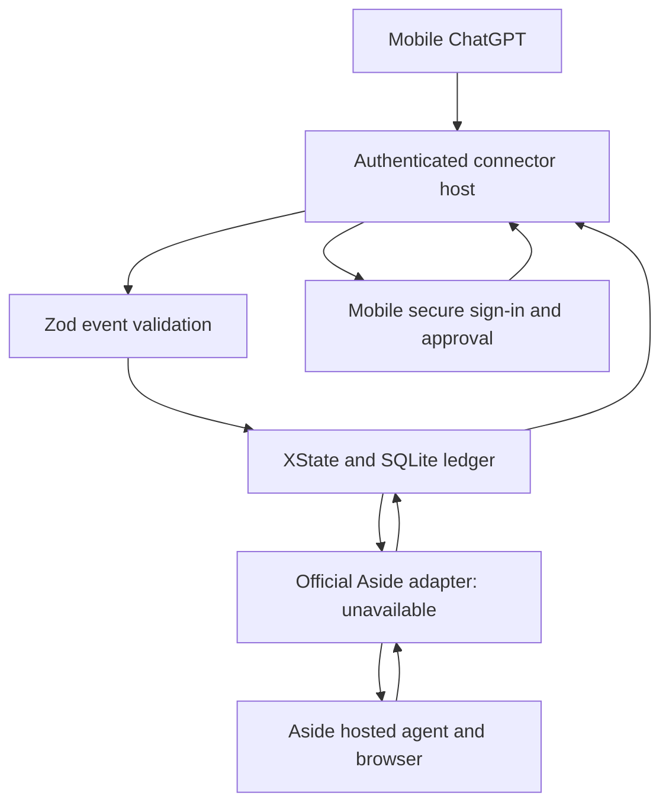

# Aside-first open-source fusion

Research date: 2026-09-12. Verdict: **NOT PUBLICLY VERIFIED** for fully mobile,
PC-free use of the official Aside agent from an external ChatGPT client.

## What the research establishes

Eight Exa searches covered four workstreams (Aside access, alternative agents,
transport, durable execution), with 64 requested result slots and primary-document
follow-up for shortlisted projects. This is a bounded review, not an exhaustive
inventory of all open source. Search snippets alone are not interface contracts.

[Aside pricing](https://aside.com/pricing) advertises Channels (Remote control),
Cloud handoff and enterprise agent runs from apps, cron jobs or internal tools.
That page was successfully retrieved in this review, supplementing the earlier
ADR-0003 retrieval limitation. These claims justify investigating enterprise
access; they do not specify a supported external hosted task protocol.
The [public documentation index](https://docs.aside.com/llms.txt),
[developer guide](https://docs.aside.com/help/developers) and
[changelog](https://docs.aside.com/changelog/components) do not establish the
complete required contract: hosted session, account authorization, task submission,
mobile sign-in, approval continuation and result retrieval without a user computer.
No unpublished endpoint was reverse engineered or used.

Aside describes its own REPL, Asidewright and modified browser in its
[engineering article](https://aside.com/blog/how-we-built-the-sota-browser-agent-that-outperforms-fable).
Using similar open-source building blocks does not produce the official Aside
agent, grant access to its service or transfer an Aside account/session.
Cloud model inference, browser synchronization, remote control of an installed
browser and a vendor-hosted browser session are distinct capabilities.

## Candidate assessment

| Project / official source | Useful role | Decision for this framework |
| --- | --- | --- |
| [XState](https://github.com/statelyai/xstate) | Explicit event/state transitions | Integrated, pinned 5.32.6, MIT |
| [Zod](https://github.com/colinhacks/zod) | Runtime validation and inferred types | Integrated, pinned 4.6.2, MIT |
| [Node SQLite](https://nodejs.org/api/sqlite.html) | Transactional durable task ledger | Integrated; Node >=22.13; no extra database service |
| [MCP TypeScript SDK](https://github.com/modelcontextprotocol/typescript-sdk) | Supported MCP server/client transport | Defer until the upstream execution/auth contract is available |
| [FastMCP](https://github.com/jlowin/fastmcp) | Python MCP server convenience layer | Alternative transport stack; adds no Aside hosting |
| [Supergateway](https://github.com/supercorp-ai/supergateway) | Translate stdio and remote transports | Cannot eliminate the process that executes local Aside |
| [Playwright](https://github.com/microsoft/playwright) | Browser control and test fixtures | Fixture testing only; no concurrent writer to Aside's session |
| [Playwright MCP](https://github.com/microsoft/playwright-mcp) | Expose Playwright browser tools | Would supply a different executor, not official Aside access |
| [Browser Use](https://github.com/browser-use/browser-use) | Independent browser agent | Not integrated; replaces the required agent |
| [Stagehand](https://github.com/browserbase/stagehand) | Independent browser action/extraction SDK | Not integrated; does not supply an Aside session |
| [Skyvern](https://github.com/Skyvern-AI/skyvern) | Independent automation agent/workflows | Not integrated; different executor and AGPL obligations |
| [LaVague](https://github.com/lavague-ai/LaVague) | World model plus browser action engine | Not integrated; different executor |
| [Browserless](https://github.com/browserless/browserless) | Hosted/self-hosted browser infrastructure | Not Aside; source-available licensing must be evaluated separately |
| [E2B](https://github.com/e2b-dev/E2B) | Isolated remote execution environments | Does not establish support for hosting proprietary Aside |
| [Crawlee](https://github.com/apify/crawlee) | Crawling and extraction | Does not implement Aside task or approval protocol |
| [Crawl4AI](https://github.com/unclecode/crawl4ai) | Web crawling and extraction | Same limitation; no need for a second crawler now |
| [Readability](https://github.com/mozilla/readability) | Extract article content from DOM | Potential optional postprocessor, not an executor |
| [Temporal](https://github.com/temporalio/sdk-typescript) | Distributed durable workflows | Defer; adds service infrastructure before provider exists |
| [DBOS](https://github.com/dbos-inc/dbos-transact-ts) | Database-backed durable workflows | Defer; vendor idempotency is still needed for remote side effects |

Only XState and Zod were installed. Other rows are assessments, not claims of
compatibility or live integration. Hosted variants, even when an SDK is open
source, can require separate commercial accounts. Nothing paid was enabled.

## Detailed target architecture

The diagram is a target, not a deployed service. Implemented: validation,
transition logic, transactional ledger, approval binding, evidence metadata,
provider-readiness checks. Unimplemented/unverified: authenticated network host,
ChatGPT mobile connector onboarding, official Aside adapter, hosted browser,
sign-in UI, callback verification and mobile end-to-end execution.

The future host runs on operator-managed cloud infrastructure with a persistent
volume, not a user's PC or home server. SQLite is a single-service starting point;
multiple service replicas require an explicit storage/concurrency design. Closing
the phone does not run any job by itself: independence requires both a deployed
host and an Aside service contract that continues jobs remotely.

## Implemented event flow

1. An authenticated host creates a tenant-scoped task. Its authentication is not
   supplied by this library; caller strings are not identity proofs.
2. Persist `SUBMIT_STARTED` before any future provider call. A crash or timeout
   must be reconciled with the provider; never automatically repeat a purchase.
3. A verified adapter normalizes provider acceptance, status and evidence into
   internal events. These names are not speculative Aside endpoints.
4. An approval request records an ID, exact-action SHA-256 digest and expiry.
   A trusted UI decision must match those fields. Recording approval has no
   execution side effect. The provider must acknowledge continuation separately.
5. Completion requires evidence labeled Aside with the matching vendor run ID,
   HTTPS final URL, title and observation timestamp. The library validates
   metadata consistency; it cannot prove that a remote action happened.
6. SQLite atomically stores each event and new revision. Same-ID/same-event
   delivery is idempotent; changed payloads and stale revisions are rejected.

Web page text remains untrusted data. It cannot authenticate a provider event,
approve an action or issue an internal state transition. Exact-action approval
must include recipient, amount, currency and destination where relevant. A hash
only binds the supplied canonical text; the future adapter must canonicalize the
complete action and detect changes before execution. No secret or cookie belongs
in event IDs, titles, URLs or evidence fields. URL query/path redaction and content
redaction are host responsibilities; a schema is not a credential detector.

## What is needed for complete implementation

Official Aside documentation or a supported enterprise contract must establish:
hosted execution without an installed user browser; account authorization;
mobile-secure login/session reuse; task submission and idempotency/reconciliation;
status and authenticated callbacks or polling; expiring approval continuation;
results/evidence; cancellation semantics; mobile external-client support.
Credentials must be provisioned through a secure account/secret flow, never pasted
into ChatGPT. Until these are verified, keep the existing provider blocked.

Adding every candidate cannot close that vendor boundary. A separate Playwright
or Browser Use service could be a different product, but would fail the requirement
that the actual agent is Aside. Nor can any framework promise every website action:
site access controls, authentication, CAPTCHA and available vendor capabilities
constrain real execution. No bypass or unsupported success claim is implemented.

PR #3 is not the primary product and must remain unmerged. This implementation
extends the Aside-first PR #7 without activating a substitute browser provider.
